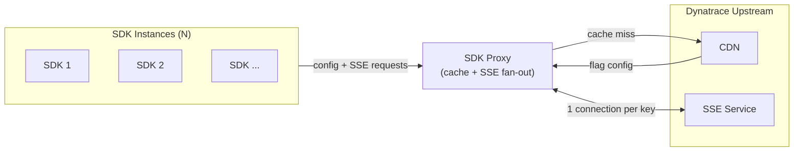

# Dynatrace Feature Management SDK Proxy

The Feature Management SDK Proxy reduces infrastructure overhead for teams running many instances of the Dynatrace
Feature Management SDK. Without it, each SDK replica maintains its own connection to the Dynatrace CDN and its own
upstream SSE subscription. With it, all replicas share one CDN connection and one SSE subscription per SDK key,
regardless of fleet size.

## When to Use It

- You run multiple replicas of an application that uses the Feature Management SDK and want to reduce CDN load.
- You want a single point of control for caching and flag update propagation across a deployment.
- You need resilience against CDN outages: the proxy continues serving cached configs even when upstream is unreachable.
- You want faster restarts with [snapshot persistence](#snapshot-persistence): new replicas come up warm without hitting
  the CDN.

## How It Works



The proxy caches flag configurations and serves them directly to SDK clients. A single upstream SSE connection per SDK
key delivers real-time flag updates to all connected replicas simultaneously.
See [docs/operations.md](docs/operations.md) for a full walkthrough of request handling, SSE fan-out, and failure
behavior.

## Quick Start

**Requirements:** Go 1.24+, or Docker.

```bash
# Build
make build

# Run
./sdk-proxy
```

The proxy listens on `:8080` by default.

### Docker

```bash
docker build -t sdk-proxy .

docker run --rm \
  -p 8080:8080 \
  sdk-proxy
```

### Kubernetes

```yaml
containers:
  - name: sdk-proxy
    image: sdk-proxy
    ports:
      - containerPort: 8080
    env:
      - name: PROXY_INSTANCE_ID
        valueFrom:
          fieldRef:
            fieldPath: metadata.name
    livenessProbe:
      httpGet:
        path: /livez
        port: 8080
    readinessProbe:
      httpGet:
        path: /readyz
        port: 8080
      initialDelaySeconds: 2
      periodSeconds: 5
```

## SDK Configuration

Point your SDK at the proxy by setting `proxyUrl` in the SDK provider config:

```json
{
  "proxyUrl": "http://sdk-proxy:8080"
}
```

No other SDK configuration is needed.

## Snapshot Persistence

Without snapshot persistence, the proxy starts cold on every restart: the first request for each SDK key triggers a CDN
fetch. With persistence enabled, the proxy saves its cache to durable storage and restores it on startup — new replicas
come up ready to serve immediately, and the proxy can survive a CDN outage at startup.

Two backends are available: `local` for single-node deployments and `s3` for multi-replica or Kubernetes deployments.

See [docs/snapshot.md](docs/snapshot.md) for setup, startup behavior, and rolling deploy guidance.

## Configuration

All configuration is via environment variables with safe defaults.

| Variable                      | Default            | Description                                                                   |
|-------------------------------|--------------------|-------------------------------------------------------------------------------|
| `CDN_BASE_DOMAIN`             | `fm.dynatrace.com` | Bare hostname for the upstream CDN.                                           |
| `PORT`                        | `8080`             | TCP port the proxy listens on.                                                |
| `LOG_LEVEL`                   | `INFO`             | Log verbosity: `DEBUG`, `INFO`, `WARN`, `ERROR`.                              |
| `SHUTDOWN_TIMEOUT`            | `30s`              | Grace period for draining in-flight requests on shutdown.                     |
| `PROXY_INSTANCE_ID`           | hostname           | Identifies this replica in usage records. In Kubernetes, set to the pod name. |
| `OTEL_EXPORTER_OTLP_ENDPOINT` | —                  | Enables telemetry export when set.                                            |
| `SNAPSHOT_BACKEND`            | —                  | Persistence backend: `local` or `s3`. Unset to disable.                       |

See [docs/configuration.md](docs/configuration.md) for the full reference.

## Health Probes

| Endpoint       | Returns 200 when                                                                |
|----------------|---------------------------------------------------------------------------------|
| `GET /livez`   | Process is running.                                                             |
| `GET /readyz`  | Proxy has a usable data source (snapshot loaded, or no persistence configured). |
| `GET /healthz` | Same as `/readyz`.                                                              |

Don't route traffic to a pod before `/readyz` returns 200.

## Documentation

- [docs/operations.md](docs/operations.md): request lifecycle, SSE fan-out, failure conditions, health and shutdown
- [docs/configuration.md](docs/configuration.md): full environment variable reference
- [docs/snapshot.md](docs/snapshot.md): snapshot persistence setup, startup paths, and multi-replica deployments
- [docs/monitoring.md](docs/monitoring.md): metrics, health probes, and what to watch in production
- [docs/telemetry.md](docs/telemetry.md): OpenTelemetry metrics and tracing reference

## Contributing

See [CONTRIBUTING.md](CONTRIBUTING.md) for development setup, test commands, and commit conventions.
